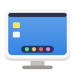
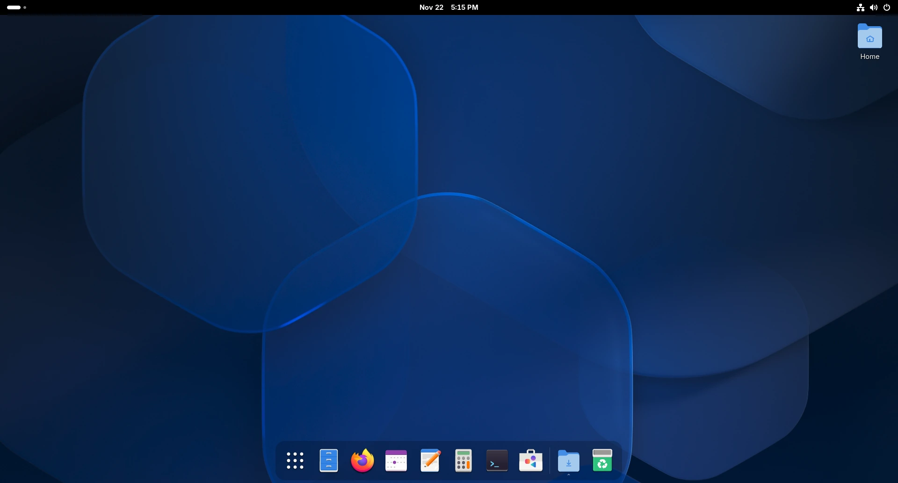
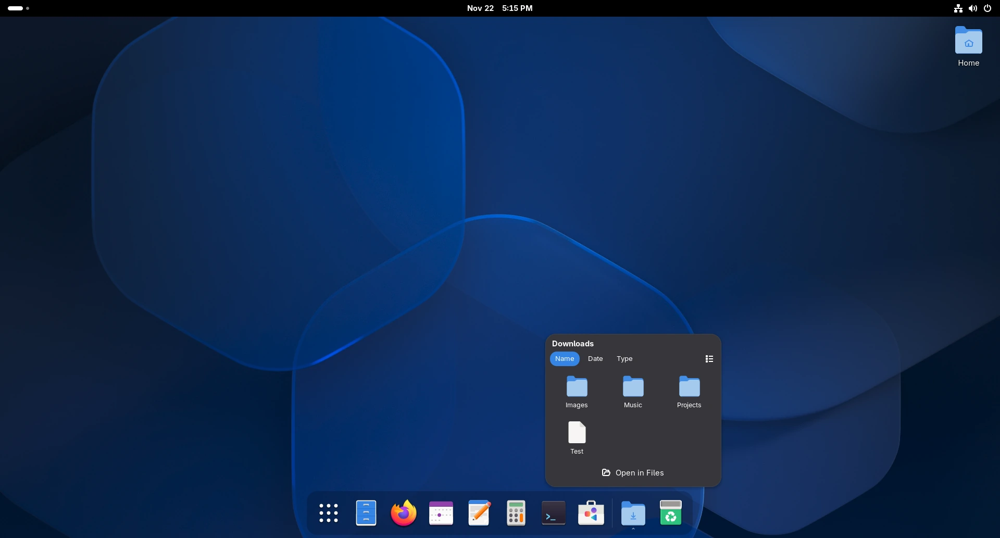
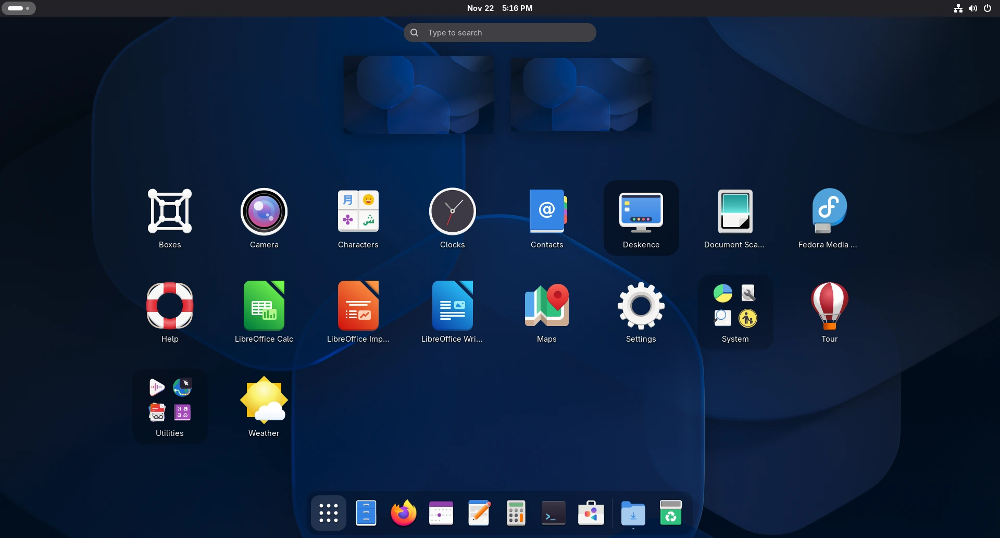
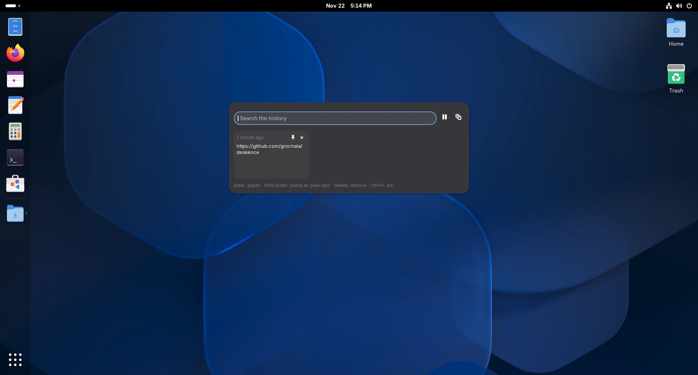
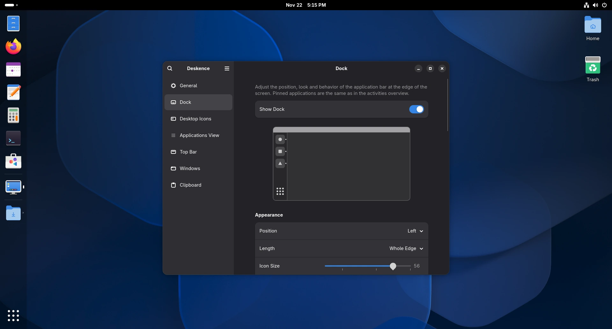

  
  <h1>Deskence</h1>
  
A GNOME enhancement suite with a customizable dock, folder stacks, window previews, 
  clipboard history, desktop icons, and a unified settings app. Built to feel native to GNOME.

  

    <a href="https://github.com/grochala/deskence/releases">Download</a> ·
    <a href="#installation">Installation</a> ·
    <a href="https://github.com/grochala/deskence/issues">Report a bug</a>
  

Deskence adds features to the standard GNOME desktop without replacing it.
It runs inside your normal GNOME session – no separate session, no fork of
GNOME Shell – and builds on GNOME Shell's own widgets and theme, so the dock
and panels follow the light, dark and high-contrast styles like the rest of
the desktop. Everything is configured in one settings application, and each
feature can be turned on and off on its own.

  
   
  <em>The Deskence dock on Fedora 45 – a native part of the GNOME desktop.</em>

## Screenshots

<table>
  <tr>
    <td width="50%" valign="top">
       
      
      <h3>Folder stacks</h3>
      Click a folder in the dock to see its contents in a panel, sorted by
      name, date or type, as a grid or a list – and open any item directly.
      Drop files on it to copy or move them there.
        
    </td>
    <td width="50%" valign="top">
       
      
      <h3>Applications view</h3>
      Applications sorted alphabetically, also inside folders, with your
      own background color and transparency and restyled folder tiles.
        
    </td>
  </tr>
  <tr>
    <td width="50%" valign="top">
       
      
      <h3>Clipboard history</h3>
      Everything you copied, searchable and one shortcut away
      (Shift+Super+V). Pin what you need often and paste straight into the
      window you came from.
        
    </td>
    <td width="50%" valign="top">
       
      
      <h3>One settings application</h3>
      Every feature on its own switch, with live previews, search
      (Ctrl+F), presets and a check for keyboard shortcut clashes.
        
    </td>
  </tr>
</table>

## Features

- **Dock** – pinned (GNOME favorites) and running applications, drives,
  the trash and the applications button. Position, length, icon size,
  magnification, auto-hide and intelligent hiding, background color and
  transparency are configurable.
- **Counters and progress** – unread counters and the progress of
  downloads on dock icons, from applications that report them
  (LauncherEntry).
- **Window previews** – live thumbnails of an application's windows when
  the pointer rests on its dock icon; close a window or peek at it from its
  thumbnail.
- **Folder stacks** – folders such as Downloads in the dock, with a panel
  that shows their contents as a list or grid. Files dropped on a folder
  (or on a subfolder in its panel) are copied or moved there through Files;
  files dropped on an application open in it when it declares their type.
  Items of the panel can be dragged onto another folder or the desktop, or
  copied and cut to paste them in Files.
- **Clipboard history** – text and images, search, pinned items, a keyboard
  shortcut and pasting into the window you came from. Kept in memory only,
  unless you choose to keep it after logging out; content marked as secret
  by password managers is skipped.
- **Desktop icons** – files and folders of your desktop folder, with file
  operations done by Nautilus (copy, move, trash, rename, undo).
- **Window management** – minimize and maximize buttons and their placement,
  and Always on Top from the dock previews or a keyboard shortcut.
- **Applications view** – alphabetical sorting with a way back to your own
  order, an optional background color or wallpaper, and the color and
  transparency of folder tiles such as "Utilities".
- **Top bar application icons** – StatusNotifierItem icons with their menus,
  for example from messengers and file synchronization tools.
- **Keep Awake** – a quick settings button that prevents suspend for a
  chosen time, optionally keeping the screen on.
- **Presets** – save, export and import your settings, undo the last
  applied preset without losing later changes, and restore defaults.
- **Settings search, shortcuts and diagnostics** – find any setting with
  Ctrl+F, manage all keyboard shortcuts in one place with clash checks, and
  copy a private-data-free report for bug reports.
- **Command line** – check, turn off, reset and restore everything with
  `deskence` commands, also from a text console when the desktop does not
  work (see [Command line and recovery](#command-line-and-recovery)).
- **Start on the desktop** – optionally begin a session on the desktop
  instead of the activities overview (needs the dock).

The interface is available in 29 languages: all official languages of the
European Union, Korean, Simplified and Traditional Chinese, Serbian and
Filipino. It follows the language of the system; the settings window and
the `deskence` command can also use another one (General page). Apart from
English and Polish, the translations were prepared with machine assistance
and still need review by native speakers; corrections are welcome, see
[po/README.md](po/README.md).

## Compatibility

| System | GNOME Shell | Status |
|---|---|---|
| Fedora 45 | 51 | Tested in a virtual machine and used daily on hardware; checked in an isolated GNOME Shell session |
| Debian 13 "trixie" | 48 | Dock, desktop icons and tray tested in an isolated session only; features added in 0.6.0 not tested yet |
| GNOME 49 and 50 (e.g. Fedora 43/44) | – | Not declared, not tested |

Deskence is at an early stage (version 0.10.0). On Fedora 45 every release
is tested in a real login session on a virtual machine and used daily on
hardware; on Debian 13 it has not been run in a real session yet. See
[docs/compatibility.md](docs/compatibility.md) for details per feature and
known limitations, and [docs/testing.md](docs/testing.md) for what has been
verified.

## Download

Packages are published on the
[Releases page](https://github.com/grochala/deskence/releases):
`deskence-<version>.rpm` for Fedora 45, `deskence-<version>.deb` for
Debian 13, and a `SHA256SUMS` file to check them. You can also build the
packages yourself as described in
[Building from source](#building-from-source).

Deskence is distributed only as native packages and as source. All runtime
dependencies are installed from your distribution by DNF or APT.

## Installation

Install the package with your package manager, which also installs the
dependencies. If you downloaded the files from a release, check them first
with `sha256sum -c SHA256SUMS --ignore-missing` in the download folder.

Fedora 45:

    sudo dnf install --nogpgcheck ./deskence-0.10.0.rpm

The packages are not signed yet, and RPM in Fedora 45 refuses unsigned
packages unless `--nogpgcheck` is given. Use it only for a file whose
checksum you verified or that you built yourself.

Debian 13:

    sudo apt install ./deskence-0.10.0.deb

When you build the packages yourself, they are in `dist/fedora-45/` and
`dist/debian-13/` under the full names the build tools give them
(`deskence-0.10.0-1.fc45.noarch.rpm`, `deskence_0.10.0_all.deb`); install
them the same way. The
`better-gnome-desktop` DEB is only a transitional package for updates from
Deskence's former name; new installations do not need it (see
[docs/migration.md](docs/migration.md)).

### First start

1. **Log out and log in again.** GNOME Shell only discovers extensions when
   the session starts. This is needed after the first installation and after
   every update.
2. Open **Deskence** from the applications view, or run `deskence`.
3. Turn on the features you want. If you open Deskence before logging in
   again, it shows a banner with a Log Out button; features you turn on are
   remembered and start in the next session.

No root access is needed for day-to-day configuration, and neither the
Extensions app nor a browser add-on is needed.

## Command line and recovery

The `deskence` command does everything the settings window does for
features, presets and defaults, without a display. It never needs `sudo`.

    deskence status                 # what is enabled and what really runs
    deskence disable dock           # turn one feature off (settings are kept)
    deskence disable --all          # turn off all of Deskence, nothing else
    deskence reset dock --dry-run   # what restoring the defaults would change
    deskence reset --all --yes      # restore all Deskence settings
    deskence preset list            # saved presets
    deskence preset apply "Work"    # apply one; "deskence preset undo" goes back
    deskence diagnostics            # a report to attach to a bug report

When the desktop does not work after logging in, switch to a text console
(for example Ctrl+Alt+F3), log in as the same user and run the commands
there: they reach the running GNOME Shell through the same session bus. If
GNOME Shell is not running, the change is saved and applies at the next
login; the command says so and ends with exit status 4. Scripts can use
`--json` and `--yes`; see `man deskence` for all commands, exit statuses
and the recovery steps.

## Turning features off and uninstalling

Each feature can be switched off in Deskence; GNOME's own behavior comes
back immediately.

To uninstall:

    sudo dnf remove deskence     # Fedora
    sudo apt remove deskence     # Debian

The running extensions stay loaded until you log out. Files on the desktop
are never moved or deleted. Your settings and data are kept; see
[docs/data.md](docs/data.md) to remove them. The title bar button layout is
a GNOME setting – restore it on the Windows page before uninstalling if you
changed it.

## Building from source

Build and test with Meson (dependencies are listed in
[docs/building.md](docs/building.md)):

    meson setup _build
    meson compile -C _build
    meson test -C _build

The tests validate the desktop file, AppStream metadata and settings schema
and run the unit tests; they do not load the extensions into GNOME Shell.

Build the RPM and DEB packages with [Podman](https://podman.io/). The
containers only provide build tools; nothing from them is needed at run
time.

    packaging/build-packages.sh

The results go to `dist/` in the repository. `dist/release/` holds the
packages as they are published on the Releases page; the other folders keep
the full names the build tools give them, the source packages and the
transitional package:

    dist/
      release/
        deskence-0.10.0.rpm                         Fedora 45
        deskence-0.10.0.deb                         Debian 13
        SHA256SUMS
      fedora-45/deskence-0.10.0-1.fc45.noarch.rpm
      fedora-45/deskence-0.10.0-1.fc45.src.rpm
      debian-13/deskence_0.10.0_all.deb
      debian-13/better-gnome-desktop_0.10.0_all.deb
      deskence-0.10.0.tar.xz
      SHA256SUMS

Pass a directory to write somewhere else: `packaging/build-packages.sh ~/packages`.

## Documentation

- [Architecture](docs/architecture.md) – components and design decisions
- [Building and packaging](docs/building.md) – dependencies, Meson options, packages
- [Compatibility](docs/compatibility.md) – GNOME versions and known limitations
- [Stored data](docs/data.md) – settings, clipboard history, presets
- [Migration](docs/migration.md) – settings migrations and the former name Better GNOME Desktop
- [Testing](docs/testing.md) – automated tests, the isolated test session, manual checklist
- [Releasing](docs/releasing.md) – how a release is prepared
- [Contributing](CONTRIBUTING.md) – reporting bugs and preparing changes

## Reporting bugs

Report bugs on the [issue tracker](https://github.com/grochala/deskence/issues).
[CONTRIBUTING.md](CONTRIBUTING.md) lists what a useful report contains.

## License

Deskence is free software under the GNU General Public License, version 3
or later (GPL-3.0-or-later); see [COPYING](COPYING). The AppStream metadata
is CC0-1.0. All code and icons were written for this project.
